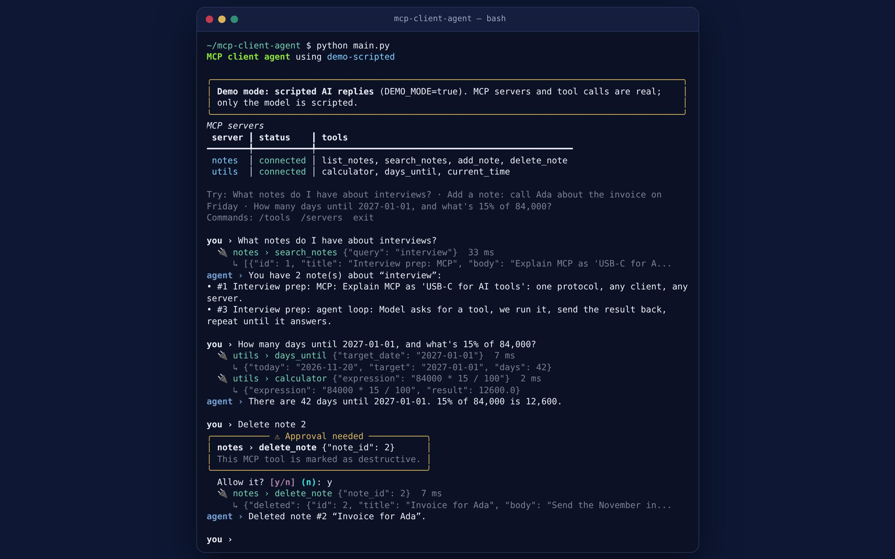

# 🔌 MCP Client Agent

> **Day 11 of [30 Days of AI Agents](https://github.com/obiokoye)**: a terminal agent that connects to any MCP server, discovers its tools at runtime, and asks you before it runs anything destructive.




```text
you › How many days until 2027-01-01, and what's 15% of 84,000?
  🔌 utils › days_until {"target_date": "2027-01-01"}  7 ms
  🔌 utils › calculator {"expression": "84000 * 15 / 100"}  2 ms
agent › There are 42 days until 2027-01-01. 15% of 84,000 is 12,600.
```

## What it shows

- **MCP (Model Context Protocol) as a client**: the agent spawns each server from `servers.json`, does the `initialize` handshake over stdio, and calls `tools/list` and `tools/call`. It never imports a server's code.
- **Runtime tool discovery**: tools aren't hard-coded. Point it at a different MCP server and the model can use that server's tools straight away.
- **Multi-server namespacing**: every tool is exposed as `<server>__<tool>` (e.g. `notes__search_notes`), so two servers can both have a `search` tool.
- **Schema translation**: MCP JSON Schemas become OpenAI-style function definitions, with keys that strict providers (Gemini) reject stripped out.
- **Human-in-the-loop safety**: tools that MCP marks as possibly destructive (`destructiveHint`, or no `readOnlyHint`) need a typed "y" before they run. Declines are sent back to the model as a tool result.
- **Resilience**: a server that fails to start is reported and skipped, tool errors go back to the model instead of crashing the chat, results are truncated, and calls time out after 30 seconds.
- **Swappable providers + demo mode**: Gemini, Groq, OpenAI or Anthropic through one OpenAI-compatible client, or a scripted fake LLM with no key at all.

## Quick start

```bash
git clone https://github.com/obiokoye/mcp-client-agent.git
cd mcp-client-agent
python -m venv .venv && source .venv/bin/activate
pip install -r requirements.txt
cp .env.example .env    # add a free Gemini key from https://aistudio.google.com/apikey
python main.py
```

### Windows (PowerShell or Command Prompt)

```bat
git clone https://github.com/obiokoye/mcp-client-agent.git
cd mcp-client-agent
python -m venv .venv
.venv\Scripts\activate
pip install -r requirements.txt
copy .env.example .env
python main.py
```

Other ways to run it:

```bash
python main.py "What notes do I have about interviews?"   # one question, then exit
python main.py --list-tools                              # show what the servers offer
python main.py --yes                                     # auto-approve destructive tools (careful)
```

Inside the chat, `/tools` lists tools, `/servers` shows server status, and `exit` quits.

## Demo mode

With no API key, or with `DEMO_MODE=true` in `.env`, the app prints **"Demo mode: scripted AI replies"** and uses `ScriptedLLM`, the same fake client the tests use. Only the model is scripted: the MCP servers start for real, and every tool call goes over MCP and hits SQLite. Try:

- `What tools do you have?`
- `What notes do I have about interviews?`
- `Add a note: call Ada about the invoice on Friday`
- `How many days until 2027-01-01, and what's 15% of 84,000?`
- `Delete note 2` (asks for approval)

## Switching providers

| `LLM_PROVIDER` | Key variable        | Default model             | Free tier |
|----------------|---------------------|---------------------------|-----------|
| `gemini`       | `GEMINI_API_KEY`    | `gemini-2.5-flash`        | ✅ |
| `groq`         | `GROQ_API_KEY`      | `llama-3.3-70b-versatile` | ✅ |
| `openai`       | `OPENAI_API_KEY`    | `gpt-4o-mini`             | ❌ |
| `anthropic`    | `ANTHROPIC_API_KEY` | `claude-haiku-4-5`        | ❌ |

Override the model with `LLM_MODEL=...`.

## Connecting other MCP servers

`servers.json` uses the same `mcpServers` format as Claude Desktop, Cursor and VS Code, so you can paste entries from a server's README. Any stdio server works, for example the official filesystem server (needs Node.js):

```json
{
  "mcpServers": {
    "notes": { "command": "${PYTHON}", "args": ["servers/notes_server.py"] },
    "files": { "command": "npx", "args": ["-y", "@modelcontextprotocol/server-filesystem", "${HOME}/Documents"] }
  }
}
```

`${VAR}` is read from the environment (on Windows use `${USERPROFILE}` instead of `${HOME}`) and `${PYTHON}` is the Python running the agent. Add `"disabled": true` to switch a server off, or `"env": {...}` to pass it settings. Run `python main.py --list-tools` to check what it found. Demo mode only has scripts for the bundled servers, so use a real key to try new ones.

## Project structure

```text
mcp_agent/
  config.py     # load servers.json (mcpServers format, ${VAR} expansion)
  hub.py        # MCPHub: spawn servers, discover + namespace tools, call them
  agent.py      # the agent loop + approval gate
  providers.py  # provider config, demo-mode fallback
  demo.py       # ScriptedLLM: fake OpenAI-shaped client for demo mode and tests
servers/
  notes_server.py   # MCP server: notes in SQLite (list, search, add, delete)
  utils_server.py   # MCP server: calculator, days_until, current_time
servers.json    # which servers to start
main.py         # terminal UI (rich)
tests/          # pytest: real MCP servers + scripted LLM, no key needed
```

## How to extend

- **New tool on a bundled server**: add a function with `@server.tool(...)` in `servers/notes_server.py`. Mark it `readOnlyHint=True` if it only reads, or `destructiveHint=True` if it deletes or overwrites. The agent picks it up on the next start.
- **New server**: write one with `MCPServer` from the MCP Python SDK (or any language) and add it to `servers.json`.
- **HTTP servers**: `MCPHub._connect` only does stdio today. The SDK also has a streamable HTTP client you could add as a second transport.

## Run tests

```bash
pytest -q
```

22 tests: config parsing, schema conversion, approval rules, and end-to-end runs that start the real MCP servers with a temporary database.

New to Python? See **[LEARN.md](LEARN.md)**, which walks through this codebase in Laravel terms.

---

MIT © Nicholas Okoye
